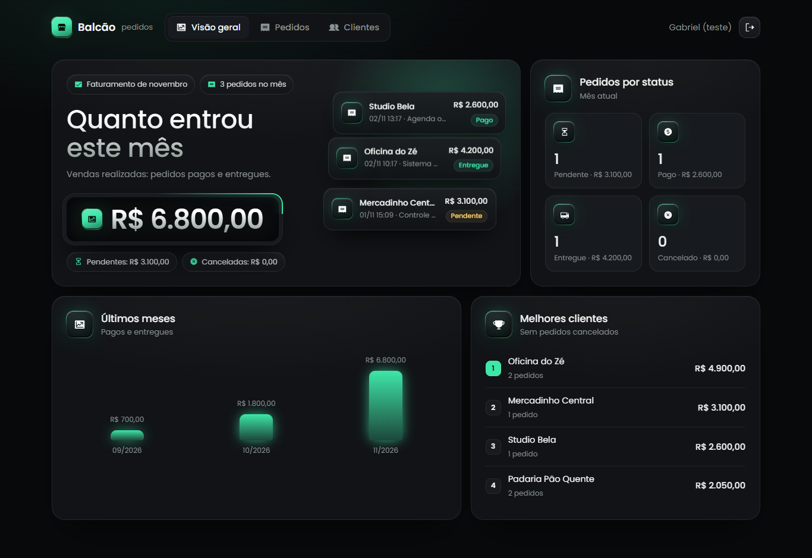
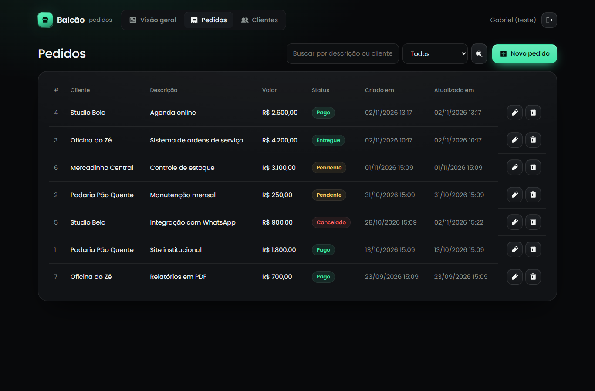

# Balcão

Painel administrativo em **PHP 8.3 + MySQL 8** para pequenas empresas: pedidos, clientes e faturamento num lugar só, com uma API JSON para integrar com outros sistemas.



## O que ele faz

- **Login** com senha criptografada (`password_hash`), sessão renovada no login e bloqueio de 5 minutos depois de 5 tentativas erradas
- **Clientes:** cadastro, edição, busca e exclusão protegida (cliente com pedidos não é apagado)
- **Pedidos:** cadastro com status, busca, filtro e paginação, com data e hora de criação e da última alteração
- **Valor com máscara de banco:** o campo só aceita números e preenche da direita para a esquerda, como no Pix (`125000` vira `1.250,00`)
- **Visão geral:** faturamento do mês, pendentes e canceladas, pedidos por status, últimos 6 meses e melhores clientes
- **API JSON** com token para listar e criar pedidos



## Regra do faturamento

| Status | Entra no faturamento? | Por quê |
|---|---|---|
| Pago | Sim | Venda realizada |
| Entregue | Sim | Venda realizada e concluída |
| Pendente | Não | Aparece separado e só entra quando vira pago |
| Cancelado | Nunca | É desistência; aparece separado para acompanhar |

O mês conta pela data de criação do pedido, no horário de Brasília (o MySQL e o PHP rodam em `America/Sao_Paulo`, então o mês vira à meia-noite, e não às 21h do UTC). A data da última alteração é gravada pelo próprio MySQL (`ON UPDATE CURRENT_TIMESTAMP`), então nenhuma tela esquece de registrá-la.

## Segurança

| Risco | Como o Balcão trata |
|---|---|
| SQL injection | Todas as consultas usam prepared statements do PDO, sem emulação |
| XSS | Tudo que vai para a tela passa por `htmlspecialchars` |
| CSRF | Todo formulário leva um token da sessão, comparado com `hash_equals` |
| Força bruta no login | Bloqueio temporário depois de 5 tentativas |
| Arquivos expostos | Só a pasta `public/` fica acessível pelo navegador |

## Rodar

Requer Docker.

```bash
cp .env.example .env
```

Troque a senha do banco e o token da API no `.env`, e suba:

```bash
docker compose up -d --build
```

Crie o seu usuário:

```bash
docker compose exec app php bin/criar-admin.php "Seu Nome" voce@email.com
```

Abra `http://localhost:8080`. O banco já vem com clientes e pedidos de exemplo, todos fictícios.

## API

Toda chamada envia `Authorization: Bearer <API_TOKEN>`.

```bash
curl -H "Authorization: Bearer SEU_TOKEN" "http://localhost:8080/api/pedidos?status=pago"
```

```bash
curl -X POST -H "Authorization: Bearer SEU_TOKEN" -H "Content-Type: application/json" -d "{\"cliente_id\":1,\"descricao\":\"Novo site\",\"valor\":\"1.500,00\"}" http://localhost:8080/api/pedidos
```

| Resposta | Quando |
|---|---|
| `200` | Lista de pedidos |
| `201` | Pedido criado, com o `id` |
| `401` | Token ausente ou errado |
| `422` | Dados inválidos, com o erro de cada campo |

O `valor` pode ir como número (`1250.5`) ou texto no formato brasileiro (`"1.250,50"`, `"1.250"`).

## Estrutura

```
docs/          prints do README
public/        index.php (rotas), assets
src/           Banco, Auth, Csrf, API e repositórios (SQL)
views/         telas
database/      schema e dados de exemplo, carregados na primeira subida do MySQL
bin/           criar-admin.php
```

## Licença

[PolyForm Noncommercial 1.0.0](LICENSE). A fonte Poppins usa a licença [OFL](public/assets/fontes/OFL.txt), e os ícones são do [Phosphor](https://phosphoricons.com) (MIT).

© Gabriel Serra da Rosa
